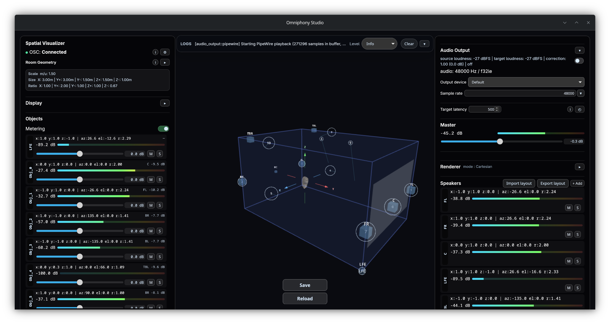

# Omniphony

**A real-time spatial / object-based audio rendering engine.** Omniphony takes
multichannel and object audio and renders it — with VBAP — to any speaker layout
or to **binaural headphones**, in real time. Open source, GPL-3.0.

[](https://omniphony.mgth.fr)

[](https://github.com/mgth/Omniphony/releases/latest)
<!-- The player lives under the mpv-v* tag namespace, which /releases/latest never
     resolves to (that is the Studio v* line) — bump these two on each mpv release. -->
[](https://github.com/mgth/Omniphony/releases/tag/mpv-v0.7.0)
[](https://github.com/mgth/Omniphony/releases/tag/mpv-v0.7.0-fel-beta.1)

**Play a film through Omniphony, step by step:**
[Linux](docs/install/linux.md) · [Windows](docs/install/windows.md) · [macOS](docs/install/macos.md)
— what to download, where each file goes, how to check each step, and the usual
failures.



- 🎧 **Hear it on headphones** — binaural output (HRTF + ITD + room reflections +
  live head-tracking), or a measured room from a BRIR set (SOFA); no surround rig
  required.
- 🔊 **Render to any layout** — stereo, 5.1, 7.1.4, 9.1.6 and beyond, via VBAP or
  the `volumetric` backend (VBAP's direction plus the object's depth in the room).
  No speaker limit in the engine (tested up to 128).
- 🧪 **Bring your own panner** — a render backend is one Lua file you edit live
  from Studio, or one Rust crate; it shows up in the UI on its own.
- 🧩 **Pluggable decoders** — a small, versioned ABI (`bridge_api`) loads decoder
  bridges at runtime, several at once, and routes each stream to the one that
  recognises it; bring your own format.
- 🛰️ **Live control + 3D visualization** — Omniphony Studio supervises the engine
  over OSC.

## Hear it in 2 minutes — no media player needed

The engine ships a self-contained demo: a reference WAV decoder bridge plus a
short multichannel clip. From a fresh clone, with a Rust toolchain, on Linux,
macOS or Windows (Git Bash; the device modes play through ASIO when an ASIO driver
is installed, and through WASAPI shared mode otherwise):

```sh
cd omniphony-renderer
./scripts/demo.sh            # builds the engine, then plays the demo on your headphones
```

`scripts/demo.sh` binaurally renders `assets/demo/spatial-demo.wav` — a source
sweeping around you with an overhead tone — straight to your headphones. No
external player, no proprietary decoder. Other modes:

```sh
./scripts/demo.sh speakers   # 7.1.4 speaker render instead of binaural
./scripts/demo.sh file       # no audio device? pipe raw float to ffplay
```

## Frontends

Omniphony is the engine; you can drive it three ways:

| Frontend | What it is |
| --- | --- |
| **`orender` CLI** | The standalone engine binary — render a stream or file to speakers, headphones, or a file/pipe. The demo above uses it. No limit on the width of the speaker layout (tested up to 128 speakers). |
| **Omniphony Studio** | Desktop app: 3D visualization, live control, metering, layout management. Installers on the [releases page](https://github.com/mgth/Omniphony/releases/latest): `.deb` and AppImage (Linux), setup and MSI (Windows), `.dmg` (macOS); each carries `orender` and the engine library, and deploys that library where mpv-omniphony looks for it. On Linux and Windows a combined installer lays down the player, the engine and Studio in one go. |
| **[mpv-omniphony](docs/mpv-omniphony.md)** | The [mpv](https://mpv.io/) media player with an opt-in spatial decoder (`--ad=orender`) that renders through the engine instead of downmixing. Layouts of up to 64 speakers: mpv's own limit ([details](docs/mpv-omniphony.md#limit-64-output-channels)); a wider one plays through `orender`. ([usage guide](docs/mpv-omniphony.md) · [source](https://github.com/mgth/mpv-omniphony)) |

[](docs/mpv-omniphony.md)

## Install on Arch

The stack is packaged on the AUR — built from source, managed by pacman like
everything else:

```sh
paru -S mpv-omniphony omniphony-studio
```

[`mpv-omniphony`](https://aur.archlinux.org/packages/mpv-omniphony) replaces the
stock mpv (`provides mpv` + `libmpv`) and pulls in
[`orender`](https://aur.archlinux.org/packages/orender) — the engine package with
the CLI and `liborender.so`, installable on its own for a player-less setup.
[`omniphony-studio`](https://aur.archlinux.org/packages/omniphony-studio) is the
Studio app, running against that system engine rather than a bundled copy. Movie
discs carrying a video enhancement layer want
[`mpv-omniphony-fel`](https://aur.archlinux.org/packages/mpv-omniphony-fel)
instead of the plain player package: same spatial decoder on an mpv master
snapshot, plus Dolby Vision Profile 7 FEL reconstruction. Decoder bridges install
the same way — search the AUR for the one your format needs.

## Which versions go together

One release number covers Omniphony Studio, the `orender` engine
and `liborender`. The player and the decoder bridges are released on their own,
and each must match the engine it runs with: the player needs a `liborender`
with its ABI major version, and a decoder bridge loads only in an engine built
against the same `bridge_api` minor version (the engine says which one it
expects in its log and in Studio's About box). Each release also carries this
row as `omniphony-<release>-manifest.json`.

<!-- compat-table:start -->
| Release (Studio, orender, liborender) | liborender ABI | Player | Decoder bridge built against `bridge_api` |
| --- | --- | --- | --- |
| [v0.7.0](https://github.com/mgth/Omniphony/releases/tag/v0.7.0) | 0.12 | [mpv-v0.7.0](https://github.com/mgth/Omniphony/releases/tag/mpv-v0.7.0) | 0.6.x |
| [v0.6.0](https://github.com/mgth/Omniphony/releases/tag/v0.6.0) | 0.8 | [mpv-v0.6.0](https://github.com/mgth/Omniphony/releases/tag/mpv-v0.6.0) | 0.4.x |
| [v0.5.2](https://github.com/mgth/Omniphony/releases/tag/v0.5.2) | 0.7 | [mpv-v0.5.2](https://github.com/mgth/Omniphony/releases/tag/mpv-v0.5.2) | 0.3.x |
| [v0.5.1](https://github.com/mgth/Omniphony/releases/tag/v0.5.1) | 0.6 | [mpv-v0.5.0](https://github.com/mgth/Omniphony/releases/tag/mpv-v0.5.0) | 0.3.x |
| [v0.5.0](https://github.com/mgth/Omniphony/releases/tag/v0.5.0) | 0.6 | [mpv-v0.5.0](https://github.com/mgth/Omniphony/releases/tag/mpv-v0.5.0) | 0.3.x |
<!-- compat-table:end -->

## How it works

`omniphony-renderer` loads one or more **decoder bridges** at runtime (`.so` /
`.dll` / `.dylib` files implementing the `bridge_api` ABI, listed in
`render.bridge_paths` or found in the engine's folders), routes each stream to
the bridge whose probe recognises it, decodes it to PCM + object metadata, and
renders it (`orender check-bridges` says which bridges it finds and loads):

- object → speaker-feed rendering through a pluggable gain backend (VBAP,
  `volumetric`, a Lua script, or your own), with loadable speaker layouts, fixed
  channels placed per source family, and an optional per-band crossover
- real-time output backends — `pipewire` (Linux), `asio` (Windows, falling back
  to WASAPI shared mode without an ASIO driver), CoreAudio
  (macOS), plus a non-realtime **file / stdout / FIFO** backend; one setting,
  `latency_target`, holds the end-to-end latency against the device clock
- binaural headphone output — HRTF, ITD, early reflections, late reverb, live
  head-tracking, or a measured room from a BRIR set
- metadata and metering over OSC; Studio on the same machine talks to it over
  loopback TCP

The reference bridge in `omniphony-renderer/reference_bridge/` (used by the demo)
is the smallest example of how to add your own decoder. See
[`omniphony-renderer/BRIDGE_API.md`](omniphony-renderer/BRIDGE_API.md).

## Components

### `omniphony-renderer` — the engine

The core engine (executable: `orender`) and its supporting crates:

- `renderer` — VBAP engine, layouts, binaural, OSC output, runtime config
- `orender_engine` — the headless decode → render session shared by the CLI
  and the library
- `orender_ffi` — the C ABI, built as `liborender` (what mpv-omniphony loads)
- `runtime_control` — live control commands, the OSC control server, config
  persistence
- `audio_output` — PipeWire / ASIO / CoreAudio / file backends
- `audio_input` — live PCM / bridge input
- `audio_sync`, `audio_rt` — the clock servo holding `latency_target`, and the
  realtime ring and resampler under it
- `host_audio` — the OSC surface for audio output and input
- `example_backend`, `script_backend` — a minimal native render backend to
  copy, and the Lua one
- `omniphony_geometry` — coordinate and room math shared with Studio
- `bridge_api` — the versioned ABI for external decoder bridges (a bridge
  loads in a host built against the same `bridge_api` minor; see
  [`BRIDGE_API.md`](omniphony-renderer/BRIDGE_API.md))
- `reference_bridge` — a reference WAV/PCM decoder bridge (powers the demo)
- `spdif` — IEC 61937 / S/PDIF parsing
- `sys` — platform integration (incl. Windows service)
- `diag` — diagnostic-metric registry feeding the Studio diag plot
- `live_log` — process logger with a runtime log level and live log streaming

Start with [`omniphony-renderer/QUICKSTART.md`](omniphony-renderer/QUICKSTART.md).

### `omniphony-studio-egui` — Omniphony Studio, supervision & control

A native (egui/wgpu) desktop app that does **not** render audio itself; it
connects to the engine over OSC to visualize objects in a 3D scene, monitor
runtime state, and control selected live parameters. Since 0.7.0 it is the
only Studio: the previous web-based (Tauri) Studio was removed, and the AUR
`omniphony-studio` package now installs this one.

## Repository layout

- `omniphony-renderer/` — engine, CLI, crates, reference bridge
- `omniphony-studio-egui/` — Omniphony Studio, the supervision / visualization app
- `osc-contract/` — the OSC address catalogue shared by the engine and Studio
- `layouts/` — bundled speaker layouts
- `script-backends/` — example Lua render backends
- `docs/` — install pages, frontend usage guides (e.g. [mpv-omniphony](docs/mpv-omniphony.md)) and design notes
- `packaging/` — installers and Arch recipes
- `assets/` — demo clip, logo, captures
- `scripts/` — helpers

## Supported platforms

"Tested" means the CI gate on every pull request to `main` builds the code and
runs its test suite on that platform; "packaged" means a release ships a
prebuilt download for it.

| Platform | Engine (`orender`, `liborender`) | Studio | Packaged |
| --- | --- | --- | --- |
| Linux x86_64 | tested | tested | yes — Studio installers, combined installer, `liborender`, AUR (from source) |
| Windows x86_64 | tested | tested | yes — Studio installers, combined installer, `liborender` |
| macOS arm64 (Apple Silicon) | tested | tested | yes — Studio `.dmg`, `liborender` |
| Linux arm64 (aarch64) | tested | not built | no — build from source |

Tests that need a sound device or a running PipeWire
session are skipped by CI on every platform, so the audio backends themselves
(PipeWire, ASIO, CoreAudio) are compiled but not exercised there. Anything not listed — macOS on Intel, 32-bit targets — is not built by
CI.

## License

GPL-3.0-or-later — see [`LICENSE`](LICENSE). Decoder bridges are loaded at runtime
via `dlopen` and may be licensed separately. The draft IAMF-in-Matroska mapping,
[`docs/iamf-matroska-mapping.md`](docs/iamf-matroska-mapping.md), is CC-BY-4.0.

## Support

Omniphony is a nights-and-weekends project, not a product. If it scratched an
itch or saved you an afternoon, a sponsorship keeps the experiments coming.

[](https://github.com/sponsors/mgth)
[](https://ko-fi.com/G5X022D1RW)
[](https://liberapay.com/mgth/donate)
